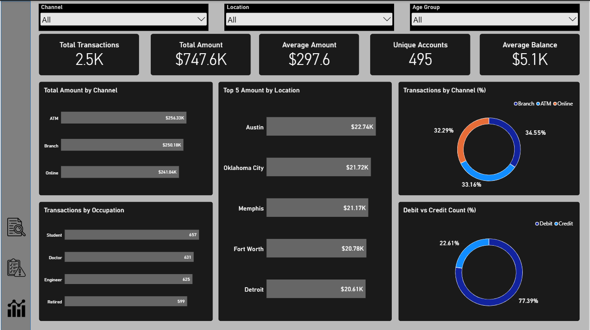
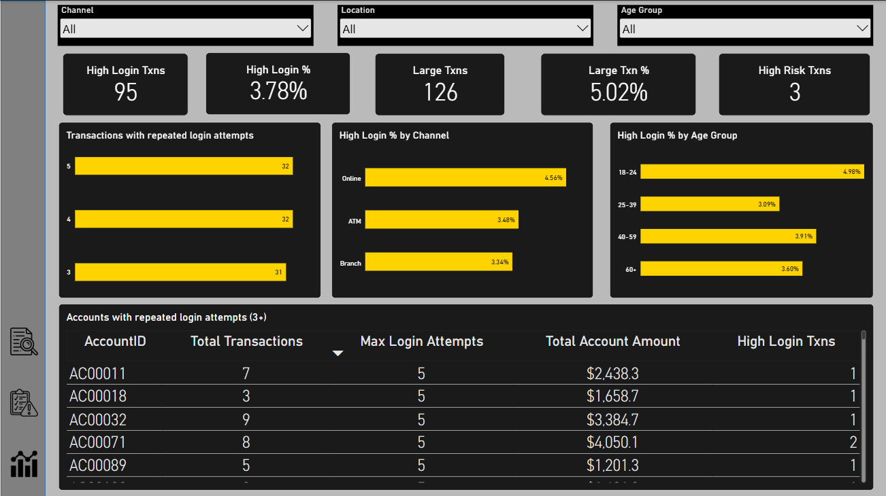
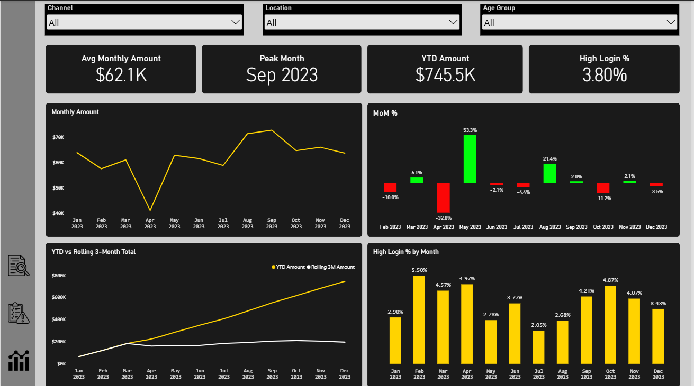

# Bank Transaction Analysis: Power BI Dashboard

An interactive Power BI report that analyzes bank transactions to understand spending behavior, channel usage, customer segments and suspicious activity patterns.

Built as a hands-on portfolio project to practice DAX, data modeling (star schema) and dashboard design for fintech analytics roles.

## Business problem

A retail bank wants to answer three questions:

1. How are customers transacting (volume, value, channel, location)?
2. Which customer segments drive the most spend?
3. Where does risky or unusual activity show up, and how is it trending over time?

## Dataset

- **Source:** Kaggle, [Bank Transaction Dataset for Fraud Detection](https://www.kaggle.com/datasets/valakhorasani/bank-transaction-dataset-for-fraud-detection)
- **Size:** 2,512 transactions across 495 accounts
- **Grain:** one row per transaction
- **Key fields:** TransactionID, AccountID, TransactionAmount, TransactionDate, TransactionType, Channel, Location, CustomerAge, CustomerOccupation, LoginAttempts, AccountBalance
- **Note:** the dataset has no fraud label. "Suspicious" activity in this project is a rule-based proxy (3 or more login attempts, top 5% by amount), not a confirmed fraud flag.

## Data model

Star schema built in Power Query and the Power BI model view.

```
Calendar ──┐
Dim_Channel ──┼──> Transactions (fact)
Dim_Location ─┘
```

| Table | Type | Key |
|---|---|---|
| Transactions | Fact | ChannelID, LocationID, TransactionDate |
| Dim_Channel | Dimension | ChannelID |
| Dim_Location | Dimension | LocationID |
| Calendar | Dimension (date table) | Date |

All relationships are one-to-many with single-direction filtering from the dimension to the fact table.

## Dashboard pages

### 1. Overview

| Question | Visual |
|---|---|
| How many transactions, how much value, how many unique accounts, what is the average balance? | KPI cards |
| Which channel carries the most amount? | Bar chart |
| What share of transactions does each channel handle? | Donut |
| Which 5 locations have the highest amount? | Top 5 bar chart |
| Which occupations transact the most? | Bar chart (transaction count) |
| What is the debit vs credit split? | Donut (transaction count) |

Slicers: Channel, Location, Age Group.

### 2. Risk (rule-based)

| Question | Visual |
|---|---|
| How many transactions had 3 or more login attempts, and what share is that? | Cards |
| How many large transactions are there (top 5% by amount)? | Cards |
| How many transactions meet both rules? | Card |
| How are repeated login attempts distributed? | Bar chart |
| Which channel and age group have the highest repeated-login share? | Bar charts |
| Which accounts have repeated login attempts? | Table |

### 3. Trends (in progress)

| Question | Visual |
|---|---|
| What is the monthly amount trend? | Line chart |
| What is the month-over-month change? | Column chart |
| What is the year-to-date amount? | Card |

## Key findings

### Overview

- Total transaction value is about **$747.6K** across **2,512 transactions** and **495 unique accounts**, with an average transaction of **$297.6** and an average account balance of about **$5.1K**.
- Spend is spread almost evenly across channels. By amount: ATM $256.3K, Branch $250.2K, Online $241.0K. By transaction count: Branch 34.55%, ATM 33.16%, Online 32.29%. Branch has the most transactions, while ATM brings in the most money, but the gaps are small.
- Students are the top occupation by transaction count (657), followed by Doctor (631), Engineer (625) and Retired (599).
- The top 5 locations by amount are Austin ($22.7K), Oklahoma City ($21.7K), Memphis ($21.2K), Fort Worth ($20.8K) and Detroit ($20.6K).
- Debit transactions make up 77.39% of transactions and credit 22.61%.

### Risk

- 95 of 2,512 transactions (3.78%) had 3 or more login attempts. Most transactions (2,390) had a single attempt.
- 126 transactions (5.02%) are in the top 5% by amount. This share is set by the definition of the threshold, so it is a rule and not a finding.
- Only 3 transactions meet both conditions (3+ login attempts and top 5% amount), making them the highest-priority cases for review.
- Online shows the highest repeated-login share (4.56%) versus ATM (3.48%) and Branch (3.34%). The 18-24 age group is highest at 4.98%. With roughly 30 to 40 flagged transactions per segment, these differences are directional, not conclusive.

### Trends

To be added once the Trends page is complete.

## DAX highlights

Full list with explanations in [`dax/measures.md`](dax/measures.md). Concepts used:

- Aggregations: `SUM`, `AVERAGE`, `COUNTROWS`, `DISTINCTCOUNT`, `DIVIDE`
- Filter context: `CALCULATE`, `ALL`, `REMOVEFILTERS`, `VALUES`
- Logic: `VAR / RETURN`, `SWITCH(TRUE())`, `IF`
- Statistics: `PERCENTILE.INC` for a data-driven risk threshold
- Time intelligence: `TOTALYTD`, `PREVIOUSMONTH`
- Ranking: `RANKX`, `TOPN`

## Repository structure

```
bank-transaction-analysis/
├── README.md
├── data/                  raw CSV (or a link if the file is too large)
├── powerbi/               .pbix report
├── dax/measures.md        all measures with explanations
└── screenshots/           one image per dashboard page
```

## Screenshots

| Overview | Risk | Trends |
|---|---|---|
|  |  |  |

## How to open

1. Download the dataset from the Kaggle link above and place the CSV in `data/`.
2. Open `powerbi/bank-transaction-analysis.pbix` in Power BI Desktop.
3. If prompted, update the data source path: Home > Transform data > Data source settings.
4. Refresh.

## Tools

Power BI Desktop, Power Query (M), DAX

## Limitations and next steps

- The data is a single snapshot with no fraud label, so risk indicators are rule-based and should be validated against confirmed fraud cases.
- The risk segments are small (about 30 to 40 flagged transactions per channel or age group), so segment differences are directional.
- Next steps: complete the Trends page, add a Region field to `Dim_Location` for a map view, and publish the report to Power BI Service.

## Author

Shubham Rana
